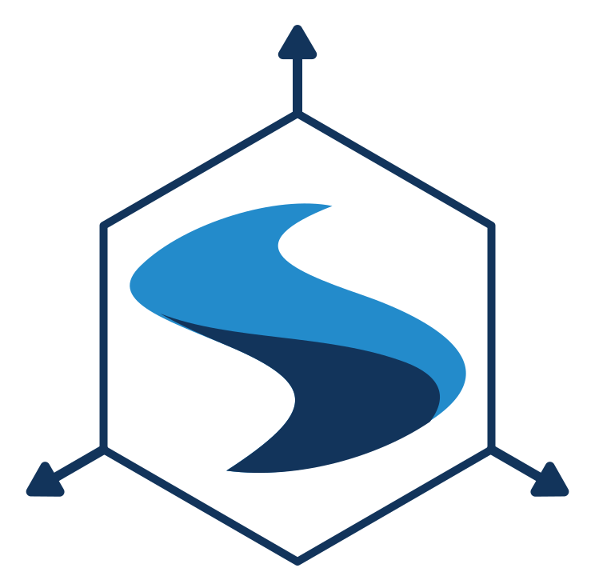
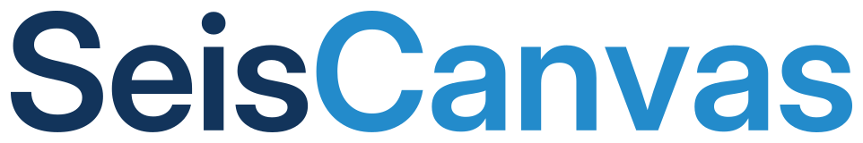
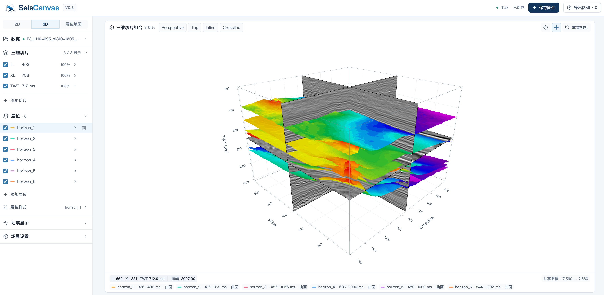

<p>
  
  
</p>

SeisCanvas 是本地运行的地震数据可视化工具，支持 SEG-Y 地震体与层位数据导入、二维剖面、三维场景、层位地图和图片导出。



## 主要功能

- **数据导入**：打开 `.sgy` / `.segy` 地震体，批量导入 `.txt` / `.dat` 层位文件，支持道头参数和层位列映射。
- **二维剖面**：浏览 Inline、Crossline 剖面，缩放、平移、读取原始振幅，调整层位线条和标记样式。
- **三维场景**：组合显示 Inline、Crossline、Time Slice 和层位曲面，调整视角、透明度、网格与配色。
- **层位地图**：查看 TWT、沿层振幅或双层位差值，支持填色、等值线、差值统计和 A–B 地震剖面。
- **图件导出**：支持 PNG、PDF、SVG，设置尺寸、字体和背景，通过导出队列预览、重命名并批量打包为 ZIP。
- **自动保存**：恢复上次工作状态和导出队列。

## 安装与启动

需要 Python 3.10+、Node.js 18+ 和 npm。以下命令从项目根目录运行。

### macOS / Linux

```bash
python3 -m venv .venv
source .venv/bin/activate
python -m pip install -r requirements.txt
cd frontend
npm ci
npm run build
cd ..
python run.py
```

### Windows（PowerShell）

```powershell
py -m venv .venv
.venv\Scripts\python.exe -m pip install -r requirements.txt
cd frontend
npm ci
npm run build
cd ..
.venv\Scripts\python.exe run.py
```

启动后在浏览器打开 <http://127.0.0.1:8000>。再次启动只需运行虚拟环境中的 `python run.py`。

## 使用方法

1. 在侧栏“数据”中导入 SEG-Y 文件。默认 Inline / Crossline 道头字节位置为 189 / 21，可按文件实际格式修改。
2. 导入层位文件并指定 Inline、Crossline、Time 列。文件可带表头，以空格或 Tab 分隔，Time 单位为毫秒。
3. 在侧栏顶部切换 **2D / 3D / 层位地图**，调整剖面位置、层位样式、色标和显示范围。
4. 点击顶栏“保存图件”，设置导出参数并“保存到队列”；在“导出队列”中预览图件，点击“导出全部”下载 ZIP。

使用 F3 示例时，将 SEG-Y 文件放入项目 `data/` 目录，层位 `.txt` 文件放入 `data/horizons/`，然后点击“加载 F3 示例”。

工作状态默认保存在系统应用数据目录，可通过环境变量 `SEISCANVAS_STATE_DIR` 指定其他目录。Linux 本地文件选择器需要桌面环境和 `python3-tk`。

## 开发运行

先启动后端 `python run.py`，再另开终端运行：

```bash
cd frontend
npm run dev
```

打开 <http://127.0.0.1:5173>，前端会将 API 请求转发到本地后端。前端检查命令：

```bash
cd frontend
npm test
npm run build
```
