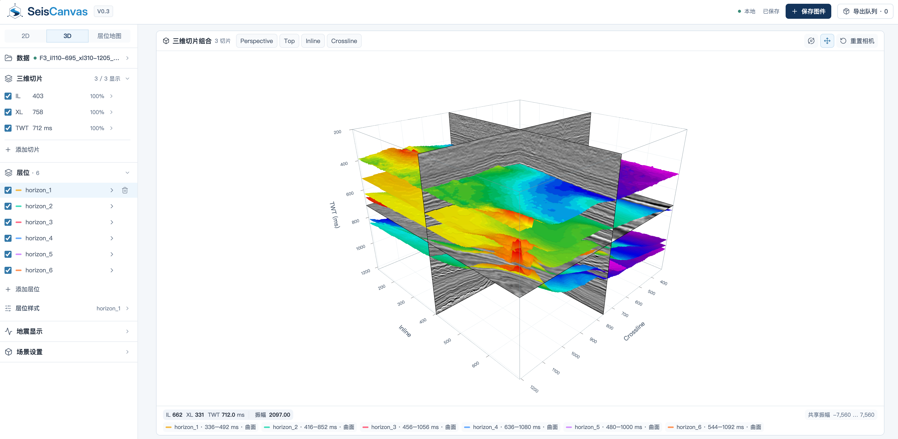

<p>
  
  
</p>

SeisCanvas **v0.5.0** 是本地运行的地震与层位可视化工具，支持二维剖面、三维场景、层位地图和图件导出。



## 主要功能

- **数据导入**：支持 SEG-Y 地震体及批量层位文件，可配置道头位置、数据列和层位对应关系。
- **项目管理**：自动保存、新建与副本、最近删除、恢复及彻底删除。
- **层位管理**：按分组整理、批量显隐和调整样式。
- **二维与三维**：Inline / Crossline 剖面、时间切片、层位曲面和切片交线。剖面缩放与平移复用概览和缓存，固定横纵比时仍可自由框选。
- **层位地图**：时间、沿层振幅和差值分析，支持填色、等值线、叠加及 A–B 剖面。
- **图件导出**：PNG / PDF / SVG 后台生成，支持预览、重命名、设置恢复和 ZIP 下载。默认名称简短，重名自动加序号。

## 安装

SeisCanvas 支持 macOS、Windows 和 Linux，在本地运行。

### macOS

**环境要求**

- Python 3.10 或更高版本
- Node.js 18 或更高版本（包含 npm）

首次安装时，在终端进入 SeisCanvas 项目目录，依次执行：

```bash
# 1. 创建 Python 虚拟环境
python3 -m venv .venv

# 2. 安装 Python 依赖
./.venv/bin/python -m pip install -r requirements.txt

# 3. 安装并构建前端
npm --prefix frontend ci
npm --prefix frontend run build
```

### Windows

在 PowerShell 中进入项目目录：

```powershell
py -m venv .venv
.venv\Scripts\python.exe -m pip install -r requirements.txt
npm --prefix frontend ci
npm --prefix frontend run build
```

---

## 启动 SeisCanvas

**macOS / Linux**

在项目目录中执行：

```bash
./.venv/bin/python run.py
```

**Windows**

```powershell
.venv\Scripts\python.exe run.py
```

启动后，在浏览器中打开：

**http://127.0.0.1:8000**

保持终端运行即可使用 SeisCanvas。结束使用时，在终端按 `Ctrl + C` 停止服务。

---

## 使用指南

### 1. 导入数据

在“数据”页面导入 SEG-Y 地震体或层位文件。

- **SEG-Y**：可在当前项目内切换，保留层位、显示设置和已保存图件。支持自定义 Inline、Crossline 道头字节位置，默认分别为 189 和 21。
- **层位文件**：按文本内容识别，不限制后缀；支持空格、Tab、逗号、分号或竖线分隔，以及 UTF-8、带 BOM 的 UTF-16/32 和 GB18030 编码。可指定 Inline、Crossline 和 Time 列，时间单位为毫秒。
- **仅导入层位**：单独导入层位文件，即可使用二维层位曲线、三维曲面、层位地图及相关分析功能。

### 2. 管理层位

按照“分组与数据 → 层位对应 → 核对导入”的流程完成导入。可在“分组与层位设置”中批量管理层位、调整显示样式。同名层位自动统一颜色。

### 3. 浏览与分析

通过顶部视图切换，在不同模式下查看数据：

- **2D**：Inline / Crossline 剖面、地震波形及层位曲线。
- **3D**：地震切片、层位曲面及空间交线。
- **层位地图**：时间图、沿层振幅图、差值图、等值线及 A–B 剖面。

部分地震振幅功能需要先导入 SEG-Y。

### 4. 导出图件

点击“保存图件”，设置文件名与导出参数，将图件添加到导出队列。

支持 PNG、PDF 和 SVG 格式，以及预览、重命名、设置恢复和批量 ZIP 下载。

### 5. 管理项目

点击顶部项目名称进入“项目管理”，统一新建、打开、重命名和创建副本。视图与层位配置自动保存，顶部保存状态可点击立即保存。

“关闭项目”保留项目；“删除”移至“最近删除”。其中可恢复项目，或彻底删除项目配置与图件（无法恢复）；原始数据文件保留。

## 项目文档

- [Linux 部署](docs/deployment-linux.md)
- [界面规范](docs/ui-design.md)
- [地震剖面渲染](docs/seismic-rendering.md)
- [层位显示与平滑](docs/horizon-display.md)

`docs/` 维护长期说明；旧方案与过程笔记存放在本地 `.local-notes/`，验收截图、日志和测量结果存放在本地 `output/`，两者均不提交。
