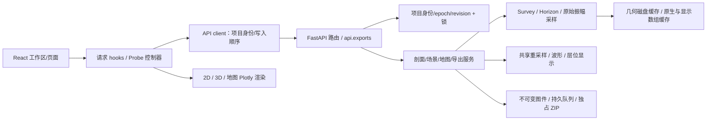

# SeisCanvas 渐进重构交付报告

日期：2026-10-21。先完成代码审查与 [实施方案](ARCHITECTURE_REFACTOR_PLAN.md)，再分三个阶段修改和验证。技术栈、产品布局、交互流程、API URL、项目保存格式及科学数据精度均保留；已确认的错误输入/竞态/错误采样行为得到修复。

本轮以启动时的源码快照为基线，保留已有未提交的项目管理、三维采样等工作；没有提交、重置或清理这些变更。快照之后另有三维相机相关改动，本轮未编辑 `Scene3D.tsx` 或 `sceneCamera.ts`，不将其计入本轮成果。下面的文件清单区分实际实施与后续建议。

## 1. 结构前后对比

```text
重构前                                 重构后（仅列出本轮结构变化）
backend/                               backend/
  main.py 985 行                         main.py 810 行：装配/项目/导入/查询
  export_service.py                      api/exports.py：11 个导出 HTTP 端点
  rendering.py                           export_service.py：渲染与队列编排
  export_queue.py                        rendering.py：图件 + 实际色阶元数据
  preview.py                             export_queue.py：事务/身份/文件生命周期
  storage.py / workspace.py              preview.py：明确的共享/逐点原始采样
                                         storage.py / workspace.py：schema 备份保护
frontend/src/                          frontend/src/
  App.tsx 1449 行                        App.tsx 1317 行：页面/工作区编排
  components/Probe.tsx                   hooks/useSectionData.ts：2D 请求和缓存
  components/SeismicViewer2D/            components/probeController.ts：光标请求生命周期
  components/SeismicViewer3D/            components/Probe.tsx：React/读数展示
                                         SeismicViewer2D/SectionPlot.tsx：串行渲染生命周期
                                         SeismicViewer3D/sceneGeometry.ts：按实际路径构造几何
tests/ + frontend/tests/               新增采样/事务/依赖边界/路由/异步回归
                                      benchmarks/：4 个可复现测量/真实数据验证脚本
                                      requirements-dev.txt + GitHub Checks 工作流
```

保留原有 `section_service`、`resample`、`trace_overlay`、`figure_export`、`profilePlotRenderer`、`captureScene` 与兼容门面 `core.py`。没有为了目录整齐大规模搬文件，也没有增加状态框架或渲染库。

## 2. 模块职责、依赖与数据流



- `Survey` 继续负责 SEG-Y 元数据、几何及按剖面读取；不将插值后的显示数据写回原生数据。
- `preview.read_samples` 默认返回“道形状 + 共享时间轴”，只有 `per_point=True` 才执行逐点采样，不再从数组形状猜测语义。地图和 3D 沿层振幅共用 `sample_horizon_amplitude`。
- `section_service.section_raster` 缓存未反极性、未裁剪的重建振幅。色标、极性和波形插值不能让无关背景缓存失效。
- `useSectionData` 管理 200 ms 防抖、覆盖率缓存、取消、迟到响应、CSS 视窗和版本/SG 检查。`resetSection` 使旧工作失效，重新加载由 meta/view/revision 变化触发。
- `SectionPlot` 把 render、resize、purge 放在同一队列；卸载后阻止新回调，等待在途工作完成后释放资源。Probe 控制器执行相同的最新选择/取消/卸载规则。
- `render_with_metadata` 一次返回不可变 `SectionRenderResult(data, colorbar_range)`；旧 `render` 继续返回 bytes。队列摘要取图件实际使用的色阶。
- 导出路由通过 `ExportContext` 的动态回调访问活动数据，不导入 `main`。保留 `ProjectRoute` 和锁内二次身份校验；这仍是单进程、单活动项目应用。
- 图件 ID 单调递增，清空队列不复用身份；ZIP 每个响应独占，成功、发送错误或取消均在 finally 清理。

后端依赖检查由实施前 26 个模块/61 条边变为 27 个业务模块/69 条边（不计空包入口），均无循环依赖；自动测试同时禁止数据/数值层导入 HTTP 或应用入口。

## 3. 已完成优化及具体文件

| 范围 | 文件 | 结果 |
| --- | --- | --- |
| 原始采样正确性 | `backend/preview.py`、`horizon_map.py` | 修复 N 道×N 样点误判、稀疏乱序查道、地图末时间样点与精确节点邻 NaN 处理；保留重复道原有取值规则 |
| 共享背景缓存 | `backend/section_service.py` | 去掉与振幅结果无关的极性/Wiggle key；覆盖跨 2D/3D 复用及范围/尺寸/时间内核/来源失效 |
| 导出重复计算 | `backend/rendering.py`、`export_service.py` | 导出只计算一次原始剖面幅度范围；六组裁剪/极性配置输出像素与元数据一致 |
| 队列与资源 | `backend/export_queue.py`、`models.py`、`api/exports.py` | 单调身份、部分文件写入清理、JSON/磁盘错误回滚、损坏/缺失队列恢复、camera 有限 JSON 校验、独立归档及断连清理 |
| 项目备份 | `backend/storage.py`、`workspace.py` | 写入和备份复用 schema 验证；损坏主项目/索引不能覆盖最后有效备份，失败提交不改变活动状态 |
| HTTP 边界 | `backend/main.py`、`backend/api/` | 提取 11 个 HTTP 适配端点，保留状态码、字体、下载字节、项目归属与修订保护 |
| 前端数据流 | `App.tsx`、`hooks/useSectionData.ts`、`sectionDisplay.ts` | 集中请求与缓存规则；Variable Area 填充色只触发本地重绘；恢复、切换和卸载阻止迟到结果 |
| 光标生命周期 | `components/Probe.tsx`、`probeController.ts` | 缓存命中、reset、卸载均使旧请求失效；保留 60 ms 延迟及原始振幅读数 |
| Plotly 生命周期 | `SeismicViewer2D/SectionPlot.tsx` | 串行 render/resize/dispose，覆盖在途操作与 StrictMode 重建 |
| 三维 CPU 分配 | `SeismicViewer3D/sceneGeometry.ts` | cell mesh 路径不再构造随后丢弃的 x/y/z/surfacecolor 四套二维数组；surface 兼容分支保留 |
| 数值告警 | `backend/horizon_map.py` | 使用有条件除法消除无效值除零告警，保留缺失区域 NaN |
| 工程保障 | `requirements-dev.txt`、`.github/workflows/checks.yml`、`README.md` | 声明现有测试依赖；配置前端测试→构建→后端测试流程；补检查与基准命令 |

新增后端测试：`test_sampling.py`、`test_storage.py`、`test_raster_cache.py`、`test_architecture.py`、`test_export_routes.py`；扩充 `test_export_queue.py`，调整两个旧测试的 spy 以对应新的实际接口。新增前端 `probeController.test.mjs`、`useSectionData.test.mjs`，扩充 `sectionPlot.test.mjs`。所有新增测试针对失败场景或稳定契约，没有增加测试框架。

## 4. 分阶段验证结果

| 阶段 | 后端 pytest | 前端 Node tests | TypeScript / Vite |
| --- | ---: | ---: | --- |
| 分析基线 | 402 通过 | 119 通过 | 成功 |
| 阶段 1：正确性/生命周期 | 452 通过 | 130 通过 | 成功 |
| 阶段 2：边界/热点 | 465 通过 | 143 通过 | 成功 |
| 最终：含路由/架构/备份检查 | **477 通过，53.45 s** | **143 通过** | **成功，构建 8.59 s** |

这是各时点整个工作区的测试总数，其中保留了其他已有/并行工作的测试；不将全部数量增量归为本轮新增。另通过 `git diff --check`、Python 源码编译和独立代理复核。复核额外做了 48 组队列辅助镜像故障注入，确认主文件提交后不会错误回滚内存。

剩余告警：现有 Starlette/httpx 测试客户端弃用告警；Vite 的运行时字体 URL 提示与约 5.29 MB 主包警告。新 GitHub 工作流已写入，尚未推送或执行远端 CI；这里报告的是本机实际结果。

## 5. 实测性能与等价性

| 测量 | 修改前 | 修改后 | 验证边界 |
| --- | --- | --- | --- |
| 真实 F3，256×896 原生剖面，900×600 目标，四种极性/波形开关组合 | 背景重建 4 次；请求合计 120.04 ms | **1 次；15.42 ms** | 原始振幅逐值一致；这是一次本机暖数据实验，几何冷/暖打开耗时不比较 |
| 三维 512² 单切片 CPU `buildTraces`，7 次中位数 | 27.80 ms | **19.23 ms** | 所有 actor 字段对照旧源码一致；不代表 GPU 帧率 |
| 三维 512² 三切片 CPU，7 次中位数 | 75.96 ms | **52.58 ms** | 去掉 3,145,728 个临时网格数值位置，保留实际 mesh、精度和 actor ID |
| 二维渲染与色阶准备，2048² float32、反极性、99.5 百分位、600 px，5 次中位数 | 297.22 ms；跟踪峰值 70.11 MiB | **249.50 ms；54.11 MiB** | PNG 字节与实际色阶相同；排除队列持久化/磁盘 IO/浏览器；内存为 tracemalloc 峰值分配，不是 RSS |

完整输入、原始测量和限制见 [性能与验证证据](output/refactor-qa/README.md)。不把局部基准外推为整个应用加速比例。

## 6. 真实数据功能验证

使用原始 **663,674,384 bytes（约 633 MiB）F3 SEG-Y** 和两组真实层位，在新的 `/tmp` QA 项目执行；原始文件大小/时间戳保持不变，用户已保存项目未参与测试。

已通过：本地 SEG-Y 导入；层位加载；Inline/Crossline 二维剖面；原始振幅查询；Wiggle/Variable Area；三方向实际 `/scene` 分支及层位曲面；地图 Time/沿层振幅/差值统计；A–B 剖面；2D、地图、A–B 各 PNG/SVG/PDF 共 9 张图；预览字节；九图 ZIP/清理；重新加载地震体、层位和队列。三个 PNG 已做人工图像检查，轴、曲线、色条与波形正常。

浏览器验收限制：CUA 返回 `Browser is not available: iab`，连接列表为空；原生 Edge 绑定长时间未返回并被中断，未取得页面状态/截图或导航至测试服务。因此本轮**没有完成浏览器内的视图切换、缩放、悬停、真实 WebGL 和 3D 捕获/队列预览实测**。3D 数据服务、几何、GPU 捕获适配器的现有模拟测试及图件封装测试已通过，仍需在可连接浏览器中补人工验收；不将这些自动化结果等同实际 GPU 验证。隔离验证服务已关闭。

## 7. 尚未解决的问题与后续顺序

1. **超大体数据的严格峰值内存上限**：实际 `scene_data` 仍先获取原生竖剖面/稠密时间平面再重建，稀疏大坐标范围可能放大分配。后续应分块并保留 Sinc8 支持域、精确百分位和缺道语义；本轮没有用低清预览替代原精度。
2. **工作区事务与地图大组件**：`main.py` 仍 810 行，`App.tsx` 1317 行，`HorizonMap.tsx` 1358 行。下一步优先抽工作区事务服务和地图/剖面请求边界；不拆成大量传递几十个 props 的小组件。
3. **锁与多项目运行模型**：进程全局状态、ProjectRoute 配置与导出队列绑定仍在；高分辨率导出可能阻塞交互请求。先测锁等待，再设计受保护快照和发布时身份复核；当前不支持多个 worker 并行共享活动项目。
4. **层位重复查询和缓存维护**：层位 section/intersection 仍可能全表筛选；几何/层位磁盘缓存缺总量配额及更完整的内容校验。索引优化须先明确 `horizon.data` 可变数据的失效规则。
5. **前端契约与渲染依赖**：地图/场景仍有宽泛 DTO、`HS/SS/VS` 等短名，读 POST 正则在前后端重复，Plotly 内部 GL 适配存在版本耦合。后续按实际功能增量收窄接口，保护现有测试；不引入预设插件框架。
6. **交付包与跨平台**：主包仍约 5.29 MB。仅改 chunk 不减少首次所需字节，应先测加载与缓存收益；Windows 文件生命周期、不同 GPU 和浏览器还需独立验证。远端 CI 执行情况也需在提交后确认。

本轮完成的是方案中三个可运行、可验证的实施阶段；以上专项问题明确保留，没有通过删除功能、降低精度或声称全面重写已完成来隐藏风险。
